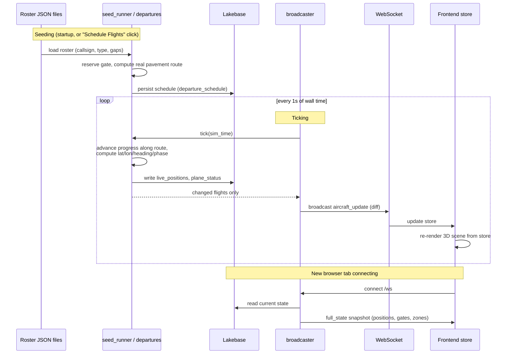
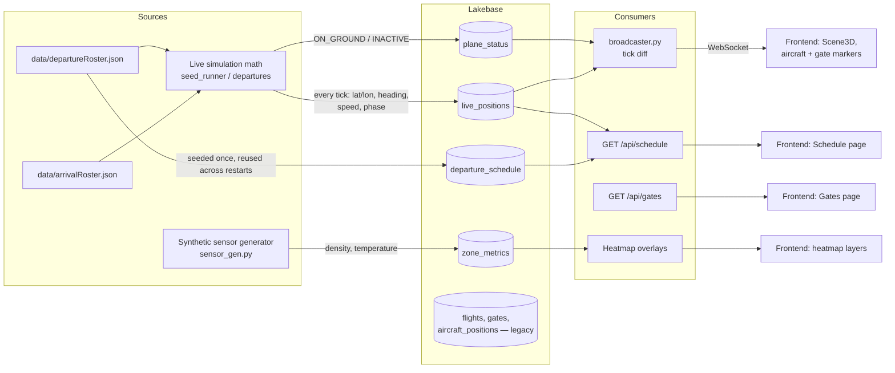

# Architecture — Hamad International Airport (HIA) Simulator

A real-time 3D simulation of HIA (Doha, Qatar): aircraft taxi real pavement
routes between gates and runways, gates have live occupancy, and a
background clock drives it all forward. One Databricks App — FastAPI backend
+ built React frontend — backed by a Lakebase Postgres database.

## 1. Overview

```
┌───────────────────────┐   WebSocket (live ticks)    ┌───────────────────┐   asyncpg   ┌───────────┐
│  Browser               │◄────────────────────────────│  FastAPI (app.py) │◄───────────►│ Lakebase  │
│  React + Three.js scene│─────────────────────────────►│  REST + tick loop │             │ (Postgres)│
└───────────────────────┘   REST (start/reset/query)   └───────────────────┘             └───────────┘
```

One Python process does everything backend-side: serves the built frontend,
runs the simulation, talks to Lakebase, and pushes updates over WebSocket.
The browser never computes a flight's position — it only renders whatever
the backend last told it.

## 2. Backend

`app.py` is the entry point. On startup it opens the Lakebase pool, seeds the
database if empty, and starts two background loops: the simulation
(`broadcaster.py`) and a sensor-data generator (`sensor_gen.py`).

| Module | Responsibility |
|---|---|
| `seed_runner.py` | Arrivals: touchdown → landing roll → real taxiway route → gate → parked → removed. |
| `departures.py` | Departures, reversed: gate → boarding pause → taxi-out → runway → takeoff → removed. |
| `taxiway_graph.py` | Builds a routable graph from the same pavement data the 3D scene draws, runs Dijkstra so aircraft follow real pavement, not hand-picked waypoints. |
| `runway.py` | Single-occupant lock — one aircraft on the runway at a time, everyone else holds short. |
| `gates.py` | Live gate registry: reserves/releases capacity-matched gates for both arrivals and departures. |
| `connections.py` | Matches authored inbound→outbound connections for the Schedule page. |
| `zones.py` / `sensor_gen.py` | Synthetic terminal metrics (density, temperature) for heatmaps — independent of flights. |
| `broadcaster.py` | The heartbeat: ticks everything once a second and broadcasts what changed. |

## 3. Frontend

Vite + React, built to static files, served directly by FastAPI — no
separate web server, no client-side router (`App.jsx` switches pages on
plain pathname checks).

- **`Scene3D.jsx`** — the home page. A custom Three.js scene, not
  map-tile-based: a fixed real-world point is the scene origin, and every
  lat/lon is projected into scene units from there. All pavement, buildings,
  and roads are static geometry built from checked-in JSON/GeoJSON — no
  basemap imagery.
- **`Aircraft3D.jsx`** — one per live flight. Stationary phases (`PARKED`,
  `BOARDING`) snap once to the server's position/heading; moving phases
  interpolate between the last two confirmed server positions so motion
  looks smooth between the ~1s server ticks.
- **`useWebSocket.js` / `useSimStore.js`** — the WebSocket connection and the
  one shared store every component reads from.
- **Pages** — `ConnectionsPage.jsx` (Schedule), `GatesPage.jsx` (gate
  occupancy), `SimulatePage.jsx` (single-flight replay).
- `MapView.jsx`/`Minimap.jsx` (a 2D deck.gl/MapLibre view) exist but are
  currently unrouted — the live app only renders the 3D scene.

Static geographic data lives in `frontend/src/data/` (and a synced backend
copy in `data/`): real OpenStreetMap-sourced pavement/buildings/roads, plus
the authored flight rosters the simulation replays. `hiaWays.json` is
deliberately kept free of anything not meant to be routable — decorative-only
pavement (e.g. the old Doha airport) lives in a separate file so it can never
enter `taxiway_graph.py`'s routing graph.

## 4. Data flow

Two loops matter: **seeding** (once, at startup or on a reset click) and
**ticking** (continuously, once a second).



Key point: the backend is the only thing that ever computes a position.
Lakebase is the handoff point between "the simulation advanced" and
"everyone watching finds out" — every tick writes there before anything is
broadcast, so a new tab reading `full_state` and an existing tab reading the
next diff always agree.

## 5. Lakebase

Lakebase is Databricks' managed Postgres — declared as a **resource** of the
app itself (`app.yaml`), so Databricks Apps injects the connection host at
runtime. The app connects as a native Postgres user
(`airport_app`); the password is resolved from a Databricks Secrets scope at
connection time rather than trusted from the raw environment variable
(`{{secrets/...}}` templates aren't resolved into env vars on Azure
Databricks Apps — the app has to fetch the real value itself). If no
password can be resolved, the pool falls back to a "demo mode" where queries
return empty results instead of failing, so the app still boots.

It buys two things: simulation state survives an app restart (a redeploy
wipes in-memory Python state, not Lakebase), and every connected browser tab
sees the same state, because there's exactly one place that state lives.

### What's in it, where it comes from, who reads it



| Table | Source of data | Consumed by | Drives |
|---|---|---|---|
| `live_positions` | `seed_runner`/`departures`, recomputed every tick from the roster + real pavement route | `broadcaster` (diffs), `GET /api/schedule` | Aircraft positions in the 3D scene |
| `plane_status` | Same tick loop — coarse ON_GROUND/INACTIVE flag | `broadcaster`, cleanup logic | Knowing when a flight is fully gone |
| `departure_schedule` | `data/departureRoster.json`, seeded once and reused | `GET /api/schedule` | Schedule page's outbound list, gate/time assignment |
| `zone_metrics` | `sensor_gen.py`, synthetic, independent of flights | Heatmap overlay endpoints | Passenger-density / temperature layers |
| `flights`, `gates`, `aircraft_positions` | `server/schema.sql`, run once on a first-ever empty database | Mostly superseded | Legacy — the live map runs on `live_positions`/`plane_status` instead |

The last row is a real rough edge, not a design choice: the schema evolved
past its original tables, and `live_positions`/`plane_status` were created
directly against the database rather than through a checked-in migration —
worth knowing if you go looking for a `CREATE TABLE live_positions` and don't
find one.

## 6. Deployment

```bash
databricks bundle deploy -p fevm01      # uploads files to the workspace
databricks apps deploy airport-simulator --source-code-path <path> -p fevm01  # restarts the app
```

Both are required every time — `bundle deploy` only uploads files, it
doesn't restart the running app. The frontend must be built
(`npm run build`) first; FastAPI serves `frontend/dist` as-is and does not
build it.
