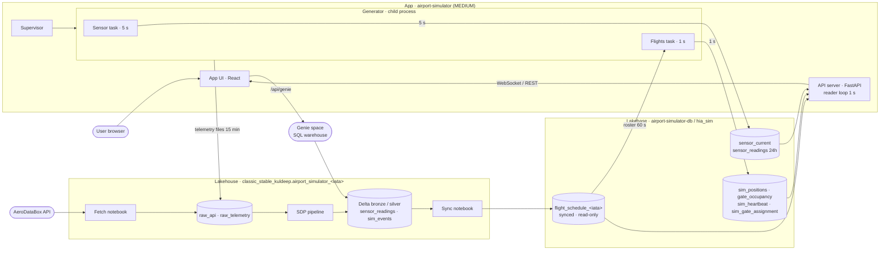
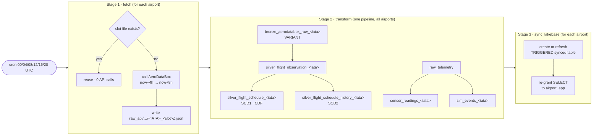
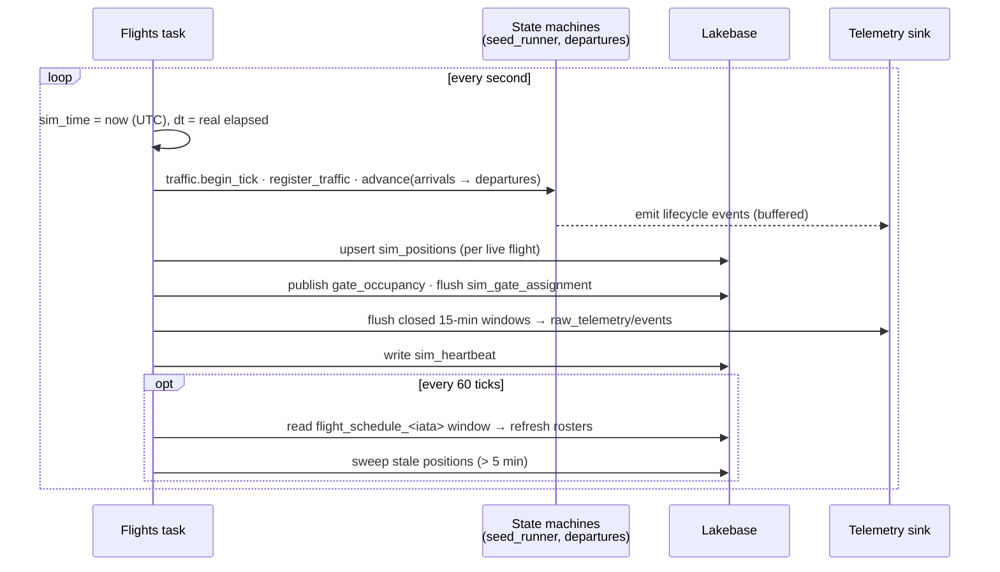
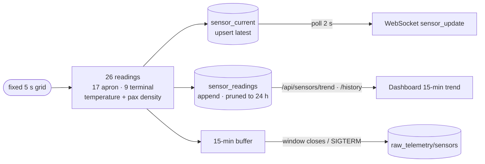
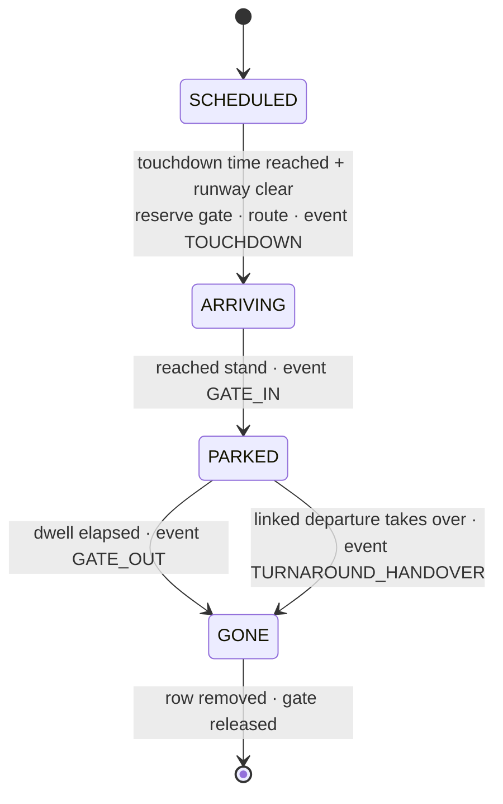
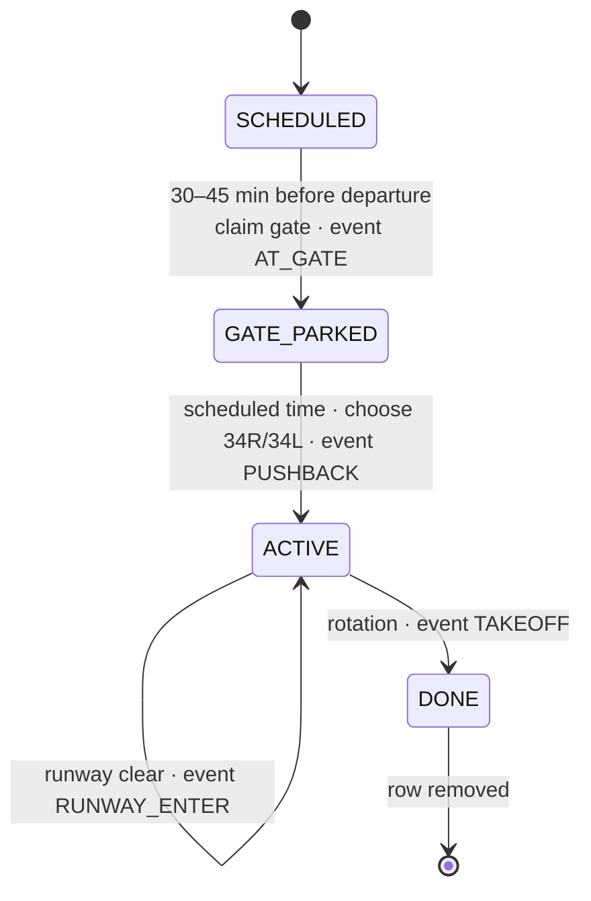
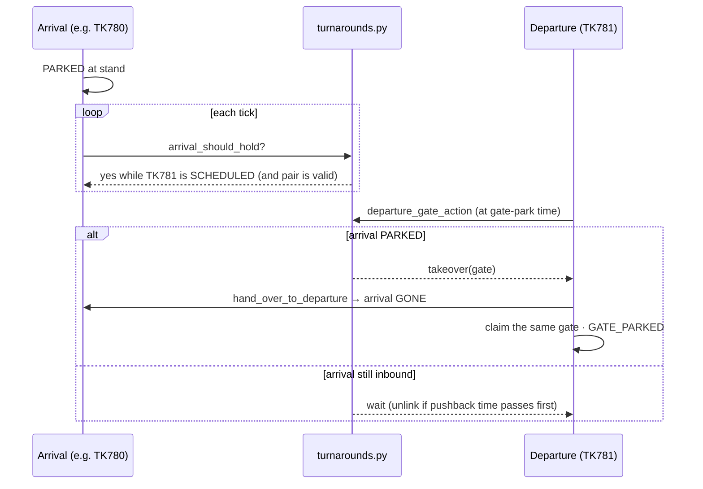
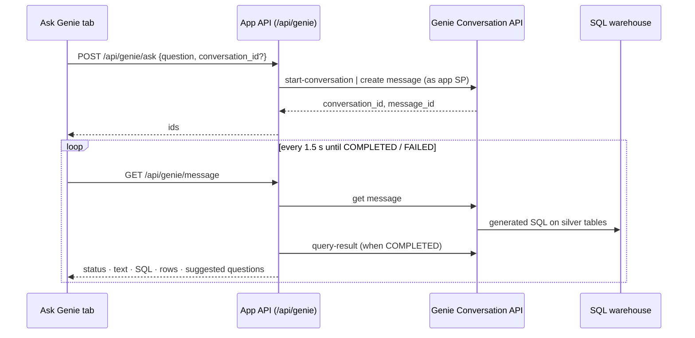

# Flow diagrams

_Current as of 2026-11-26. Prose: [APPFLOW.md](APPFLOW.md) · boundaries and tables: [ARCHITECTURE.md](ARCHITECTURE.md)._

## 1. Architecture

## 2. Ingest job (every 4 hours)

## 3. Generator — flights task (1 Hz)

## 4. Generator — sensor task (every 5 s)

## 5. Arrival lifecycle

## 6. Departure lifecycle

## 7. Turnaround handover (data/turnarounds.json)

## 8. Ask Genie request

